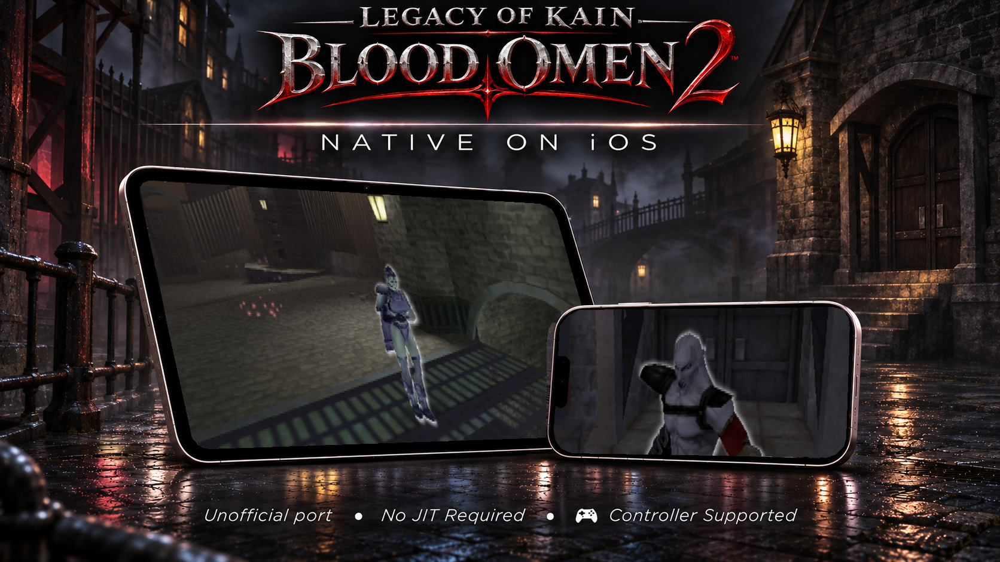
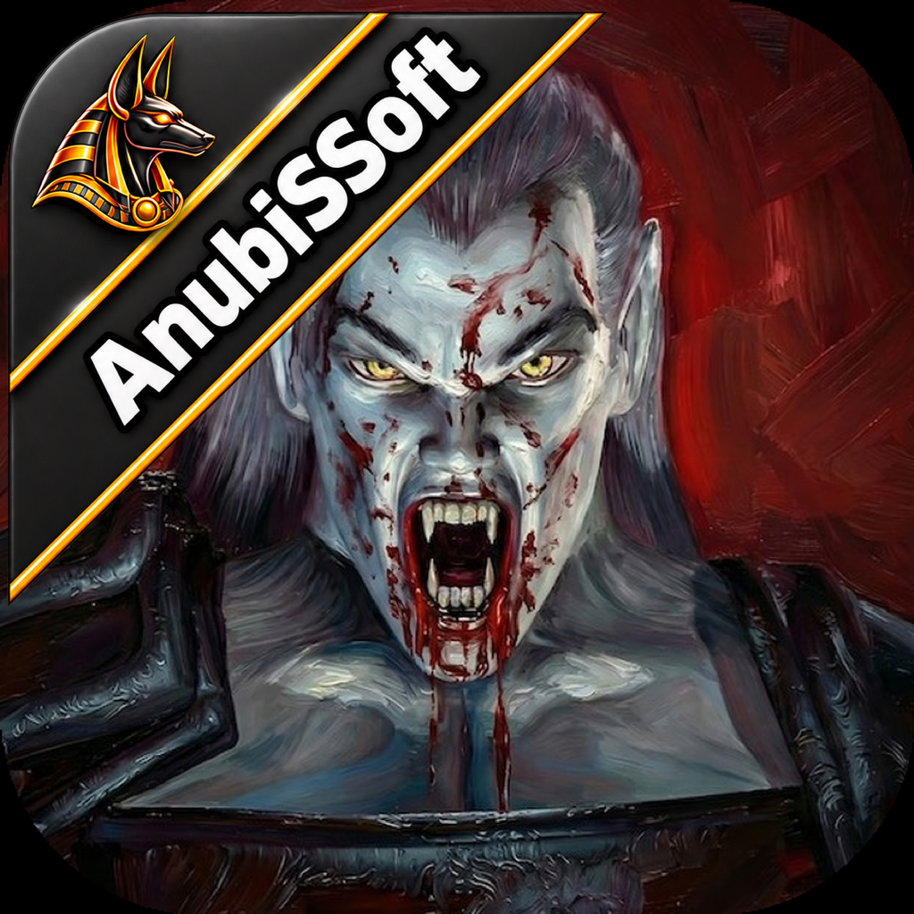

# Legacy of Kain: Blood Omen 2 — Native iOS Port

An independent, title-specific project bringing the PlayStation 2 version of *Legacy of Kain: Blood Omen 2* to iPhone and iPad using ahead-of-time ARM64 compilation and a Metal-backed graphics runtime. **No JIT required.**

> Unofficial fan-made project. Not affiliated with or endorsed by the original developers, publishers, Apple, or Sony. All game names, characters and trademarks belong to their respective owners.

## Project status

The port has reached gameplay on a real iPhone. Initial device testing reported a smooth, sustained **50 displayed FPS** at the native PAL resolution. Higher resolution presets are available for testing, with actual performance dependent on the device and scene. The launcher, controller integration, and graphics controls are under active development.

The banner's device screens contain real frames captured from the port; the surrounding cinematic recreation of the Slums district of Meridian is promotional artwork. [View the alternate concept banner](output/BloodOmen2-Concept-Banner.png).

## Features

- Native ARM64 ahead-of-time game runtime; no JIT or jailbreak required.
- Dedicated Metal graphics backend and a software compatibility option.
- Fixed Play panel with separately scrollable pre-game settings; game launches only after an explicit Play press.
- PAL 25/50 FPS presentation options, FPS counter, full-screen and aspect-ratio modes, image filtering and real internal render-resolution presets.
- PlayStation layout by default; Xbox and Nintendo Switch-style layouts are also available.
- Touch controls with adjustable size, opacity and position, button mappings, analog sticks and physical controller support.
- Automatic on-screen control visibility when an external controller connects or disconnects, controller-family indicator colors and press feedback.
- In-game controller menu, layout editing and button remapping.

## Graphics presets

| Preset | Internal resolution | Native pixel sample workload |
| --- | --- | ---: |
| 1 — Native (recommended) | Approx. 480–576p | 1× |
| 2 — Balanced | 2× horizontal, 1× vertical | 2× |
| 3 — High | Approx. 960–1152p | 4× |
| 4 — Ultra | Approx. 1440–1728p | 9× |
| 5 — Maximum | Approx. 1920–2304p | 16× |

These are real internal rendering settings, not just output scaling. The game can change framebuffer dimensions across scenes. Native is recommended for maximum performance; higher presets may reduce FPS. Graphics changes apply on the next launch.

## Requirements

- iPhone or iPad with iOS/iPadOS 18 or later (current deployment target) and compatible Metal-capable hardware. Device compatibility is not guaranteed.
- A lawfully obtained original **PS2 PAL disc image, SLES-50771** (ISO). Other revisions are not validated.
- A compatible iOS signing/sideloading method for unsigned test builds.

The standalone app requires the original ISO separately; it does not bundle the original disc image, BIOS or console keys.

## Installation (when a release is available)

1. Download the standalone IPA from [Releases](https://github.com/yikalchev/blood-omen-2-ios-port/releases) and sign/install it with your preferred compatible sideloading tool.
2. Open the app and copy your original ISO into **Files → On My iPhone → Blood Omen 2 → game**, or use **Select ISO…** in the launcher.
3. Set your graphics, frame rate and controls, then press **Play**.

At the native resolution, select 50 FPS for the full PAL refresh rate. The app maintains a separate virtual PS2 memory card.

## Controller shortcuts

| Input | Action |
| --- | --- |
| Tap controller icon | Toggle touch overlay |
| Hold controller icon or L3 for 3 seconds | Open controller menu |
| Hold L3 + R3 for 3 seconds | Open controller menu |
| Hold R3 for 3 seconds | Toggle analog controls |
| Hold 3D or the layout button | Open game settings |

The controller menu provides Choose layout, Button mapping, Edit layout and Close menu. Short L3/R3 presses keep their normal game functions.

## Releases and support

This repository is an informational showcase. Public binary releases will be announced in [Releases](https://github.com/yikalchev/blood-omen-2-ios-port/releases) once distribution requirements are addressed. Please use [Issues](https://github.com/yikalchev/blood-omen-2-ios-port/issues) for reproducible compatibility or performance reports with device model, OS version, selected resolution and game scene.

## Credits and third-party notices

This project is built using PS2Apple, the [ps2-native-recomp](https://github.com/exoteric33/ps2-native-recomp) compiler/runtime, [wgpu-native](https://github.com/gfx-rs/wgpu-native) and [SDL](https://github.com/libsdl-org/SDL). The upstream compiler/runtime is MIT-licensed; components of the iOS launcher carry GPL-3.0-or-later notices. All third-party components retain their respective license terms. Any binary release must include the required notices and make applicable corresponding source available under those terms.

This repository does not provide a build kit or original game disc image. Development source, logs, internal scripts, caches, and local build materials are kept outside the public Git history.
